just a fun project,
uses raylib

# build
if you want to compile it yourself on windows with gcc/mingw:

`gcc main.c -o main.exe -O3 -s -L. -lraylib -lopengl32 -lgdi32 -lwinmm`

or just run `main.exe` by clicking on it (make sure the `presets` folder is in the same directory if you want to load presets)

# sim

it'll open a terminal window for [options](#options),
after that it'll spawn a fullscreen borderless window of conways gol running at 60 fps

each cell will be one pixel, matching your monitor's resolution, and the screen loops around at the edges like a torus
so sure lets say its a 2d projection of a torus

you can press `esc` at any time to close the window, and the terminal will print out how many generations the simulation ran for

## options
from the terminal menu you can pick between 3 options:
1. input a custom string seed
2. choose a preset (loaded from `./presets`)
3. random noise

### seed
you can place any text you like (up to 4095 characters)
it'll grab your string, grab each character and from its 8-bit ascii value it'll fill in cells periodically

example:
seed: "hello world"
that gets translated to "01101000 01100101 01101100 01101100 01101111 00100000 01110111 01101111 01110010 01101100 01100100"

it gets joined together and now the first 88 cells of your program follow that state:
0110100001100101011011000110110001101111001000000111011101101111011100100110110001100100

it'll just loop those cells across the entire screen, as if all the pixels were in one contiguous line one row after the other

#### hello world
"hello world" after a ~minute of being spawned in

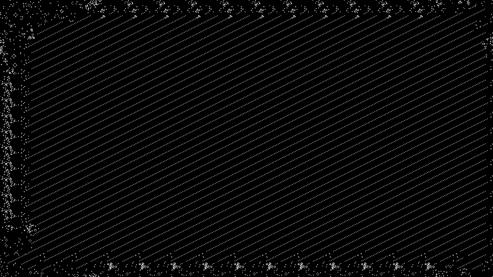

"hello world" after it stagnates


#### fcyvgbhnjmkhubg vyftc drxctfgvhbjnkmlk,;m nkbjhgvhgbjhknm

another cool seed is "fcyvgbhnjmkhubg vyftc drxctfgvhbjnkmlk,;m nkbjhgvhgbjhknm", making these cool diagonals and setting off a bunch of gliders

first it starts off like this

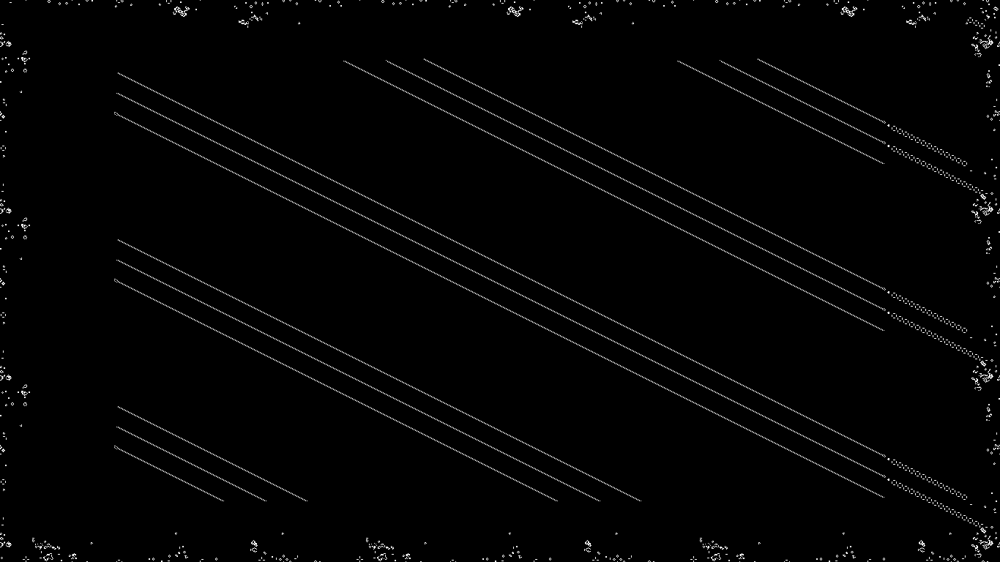

continuing like this, the gliders start going off at the left side

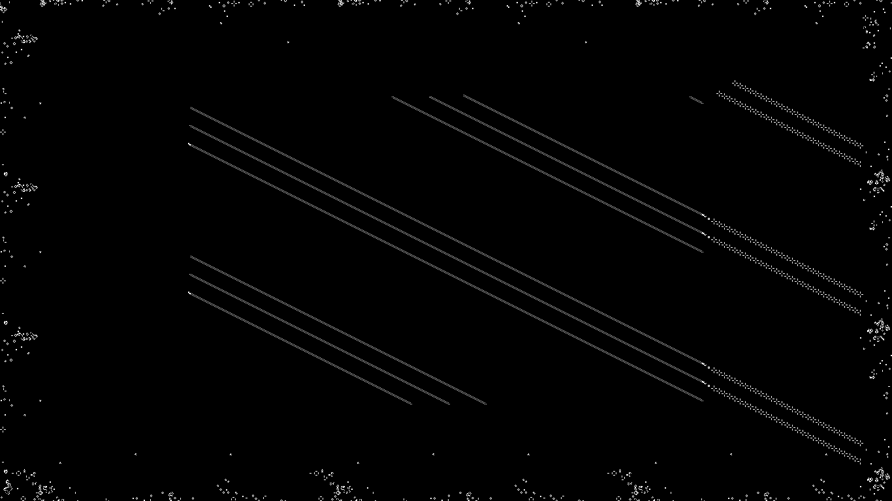


shoutout to these two gliders


who collide into this mass, releasing that top glider


which eventually


meets up with this other glider


which end up in this single glider baby


#### greenday's holiday lyrics

if you input the entire lyrics to Holiday from Green Day (converting new lines to spaces), you get

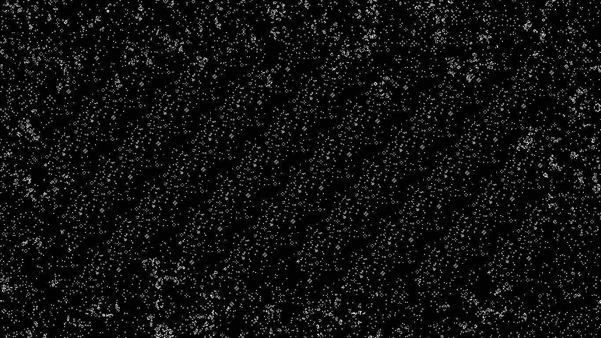


#### "just a fun project,"
inputting that string ends up with

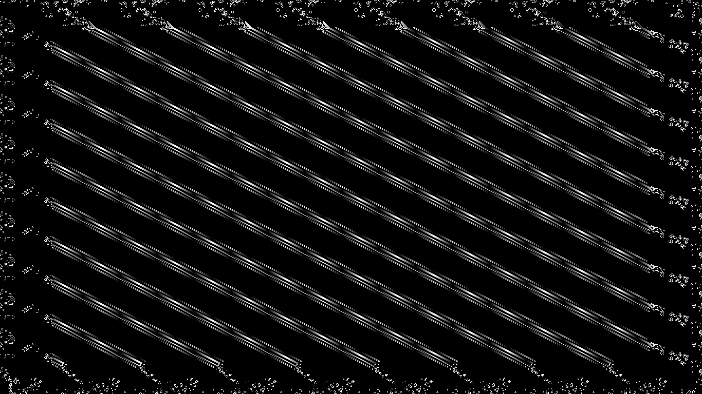

later becoming

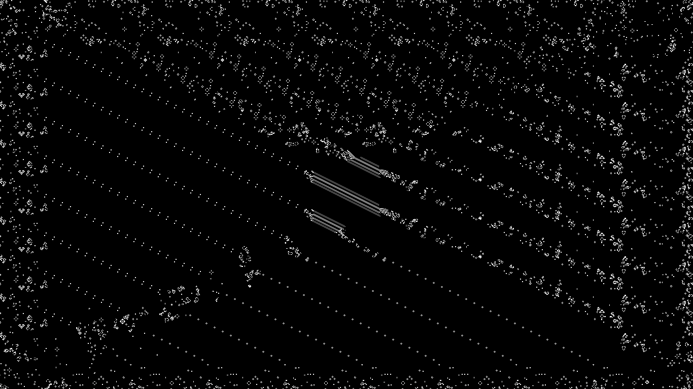

eventually stagnating to

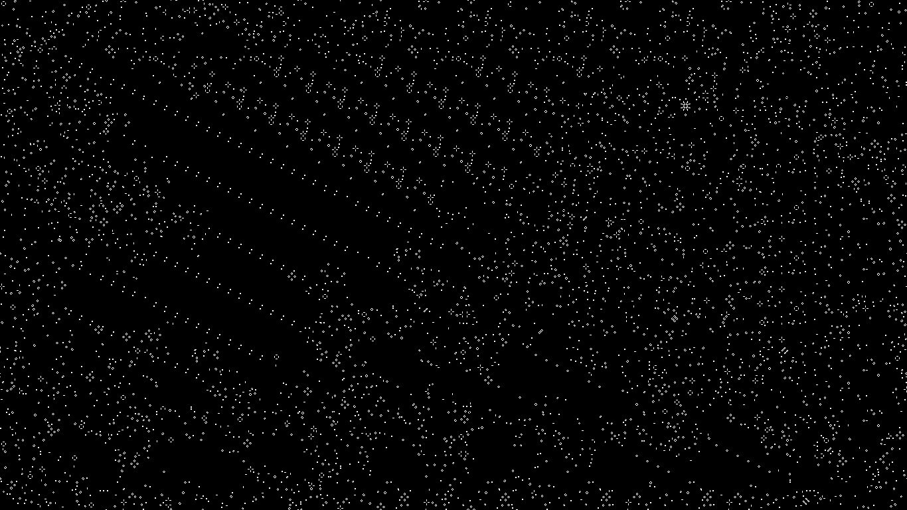

#### this README.md

if you just place this entire readme as the seed (converting new lines to spaces), you get

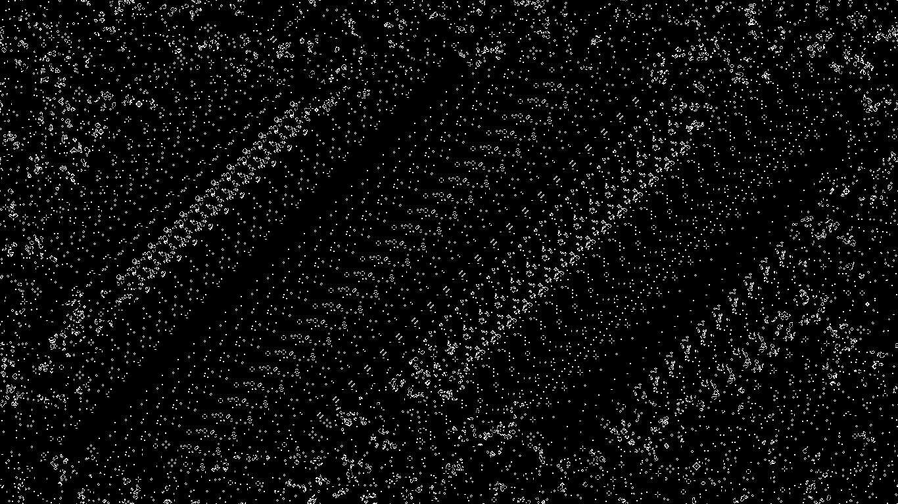

### preset
presets are loaded from `.dat` or `.txt` files inside the `./presets` folder (up to 10 files). you can make your own by following this format:

```text
name:gosper glider gun
position:0.25,0.25
000000000000000000000000100000000000
000000000000000000000010100000000000
000000000000110000001100000000000011
000000000001000100001100000000000011
110000000010000010001100000000000000
110000000010001011000010100000000000
000000000010000010000000100000000000
000000000001000100000000000000000000
000000000000110000000000000000000000
```

`position` is a ratio from `0.0` to `1.0` of your screen's width and height for where the top-left corner of the pattern spawns.

the main preset right now is a glider gun, which will be made at about 1/4\*monitor width, 1/4\*monitor height and just create gliders

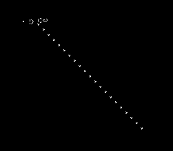

they'll go around the whole screen, eventually coming back to the glider gun after like 15 minutes i think and destroying it

however once destroyed it ends up not interfering anymore and you have a cool loop of probably a thousand gliders with a gap

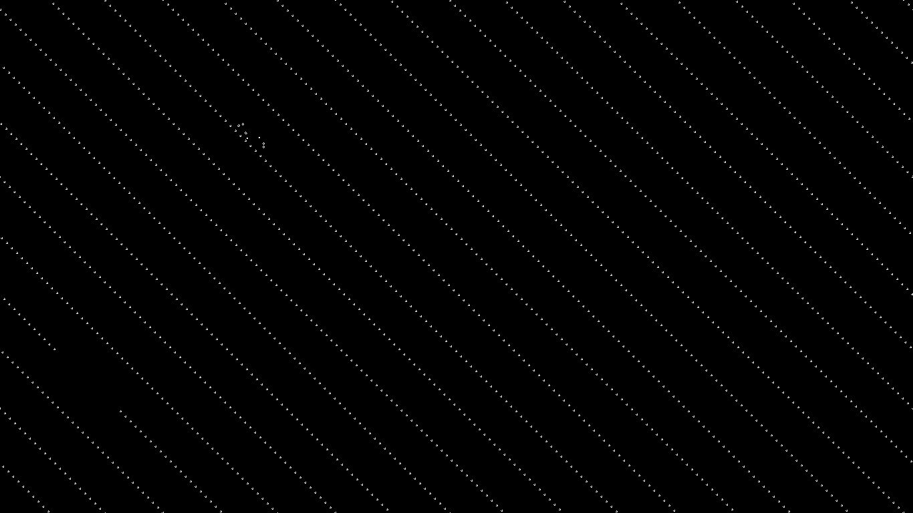

### random noise
the 3rd option in the menu is random noise (roughly 30% live cells across the screen), and yeah its cool

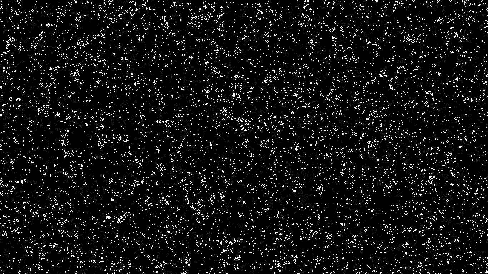