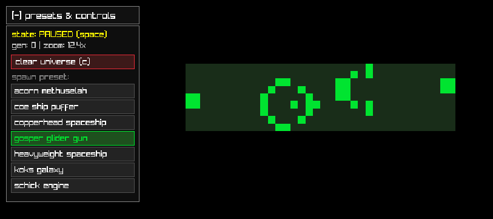
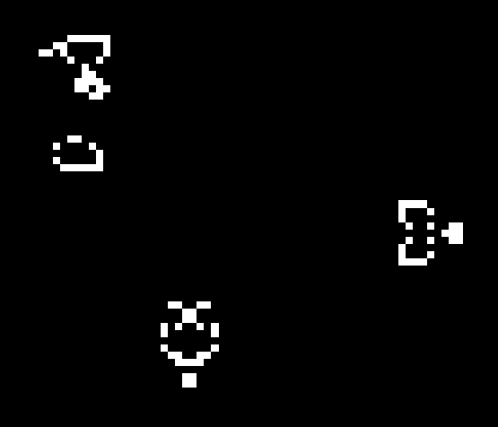

a conway's game of life sandbox written in c using raylib

# build
to compile on windows with gcc/mingw:

`gcc main.c -o main.exe -O3 -s -L. -lraylib -lopengl32 -lgdi32 -lwinmm`

or just run `main.exe` directly (keep the `presets` folder in the same directory so the program can load your `.dat` / `.txt` patterns)

# overview

launching the program opens a terminal prompt where you pick your starting universe state, then opens a borderless fullscreen simulation at 60 fps

at `1.0x` zoom, each cell maps to 1 pixel of your monitor's resolution, and the edges of the screen wrap around both horizontally and vertically like a 2d torus. once inside the simulation, you can pause, zoom in up to `64x`, pan around, draw or erase cells directly with your cursor, and stamp custom presets anywhere on the board



# controls

| input | action |
| :--- | :--- |
| `space` | pause / resume the simulation |
| `s` | step forward 1 generation (while paused) |
| `tab` | toggle the in-game presets & controls menu |
| `c` | clear the entire universe (sets all cells to dead) |
| `r` | reset camera zoom (`1.0x`) and pan position |
| `mouse wheel` | zoom in / out toward the cursor (`1.0x` to `64.0x`) |
| `right / middle click + drag` | pan the camera around the grid |
| `left click + drag` | draw or erase cells along the cursor path |
| `left click` (with preset active) | stamp the green preset shadow onto the grid |
| `left shift + left click` | stamp multiple copies of the active preset without deselecting it |
| `right click` (with preset active) | cancel the active preset shadow |
| `esc` | close the window and print total elapsed generations in the terminal |

### drawing & stamping presets
- **freehand drawing:** clicking a dead cell latches your brush to draw mode (`1`); clicking a live cell latches your brush to erase mode (`0`). dragging the mouse interpolates a continuous line so fast cursor movements don't leave gaps, and temporarily pauses evolution until you release the mouse button
- **preset stamping:** open the top-left menu (`tab`), click any loaded preset, and a green preview shadow will follow your cursor showing both the live cells and the bounding box footprint. click anywhere to place it, or hold `left shift` to stamp multiple copies across the map without having to select the preset again



# startup options
from the initial terminal menu you can pick between 4 starting modes:
1. input a custom string seed
2. choose a preset (loaded from `./presets`)
3. random noise
4. empty universe (starts paused on a blank board)

### 1. custom string seed
you can input any text string (up to 4095 characters). the program converts each character into its 8-bit ascii binary representation and loops that bitstring across every row of the screen

for example, `"hello world"` translates to 88 bits:
`0110100001100101011011000110110001101111001000000111011101101111011100100110110001100100`

because that bit pattern repeats across the width of your screen, different string lengths create distinct phase shifts from one row to the next, producing geometric tapestries and glider nurseries:

| `"hello world"` (stagnated) | `"fcyvgbhnjmkhubg vyftc drxctfgvhbjnkmlk,;m nkbjhgvhgbjhknm"` | entire `README.md` as a seed |
| :---: | :---: | :---: |
|  |  |  |

### 2. presets
presets are loaded automatically at startup from `.dat` or `.txt` files inside `./presets` (up to 10 files). you can spawn one immediately from the terminal or load them anytime from the ingame menu

to add your own preset, create a `.dat` or `.txt` file inside `./presets` with this structure:

```
name:gosper glider gun
position:0.25,0.25
000000000000000000000000100000000000
000000000000000000000010100000000000
000000000000110000001100000000000011
000000000001000100001100000000000011
110000000010000010001100000000000000
110000000010001011000010100000000000
000000000010000010000000100000000000
000000000001000100000000000000000000
000000000000110000000000000000000000
```

- `name:` sets the label shown in the terminal and in-game menu
- `position:` sets the default `x,y` screen ratio (`0.0` to `1.0`) used when spawning the preset from the initial terminal prompt


### 3. random noise
fills the grid with a ~30% density soup of live cells


### 4. empty universe
initializes a blank grid and starts the simulation in a `PAUSED` state so you can immediately open the preset menu or draw patterns by hand without them evolving while you set things up