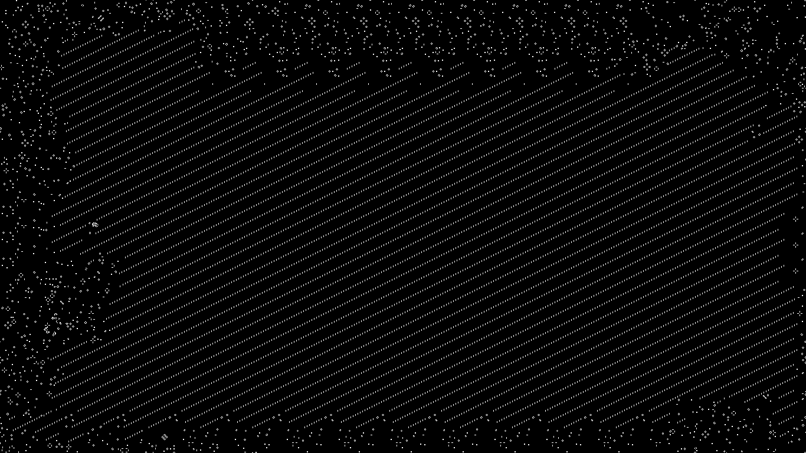
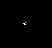

just a fun project,
uses raylib

# build
`gcc main.c -o main.exe -O3 -s -L. -lraylib -lopengl32 -lgdi32 -lwinmm`

or just run main.exe by clicking on it

# sim

it'll open a terminal window for [options](#options),
after that it'll spawn a fullscreen window of conways gol

each cell will be one pixel, the screen loops around like a torus
so sure lets say its a 2d projection of a torus

## options
you can either input a seed or choose a preset

### seed
you can place any text you like
it'll grab your string, grab each character and from its ascii value it'll fill in cells periodically

example:
seed: "hello world"
that gets translated to "01101000 01100101 01101100 01101100 01101111 00100000 01110111 01101111 01110010 01101100 01100100"

it gets joined together and now the first 88 cells of your program follow that state:
0110100001100101011011000110110001101111001000000111011101101111011100100110110001100100

it'll just loop those cells across the entire screen, as if all the pixels were in one contiguous line one row after the other

"hello world" after a ~minute of being spawned in

"hello world" after it stagnates

another cool seed is "fcyvgbhnjmkhubg vyftc drxctfgvhbjnkmlk,;m nkbjhgvhgbjhknm", making these cool diagonals and setting off a bunch of gliders

first it starts off like this

continuing like this, the gliders start going off at the left side

shoutout to these two gliders

who collide into this mass, releasing that top glider

which eventually

meets up with this other glider

which end up in this single glider baby

### preset
the only real preset right now is a glider gun, which will be made at about 1/4\*monitor width, 1/4\*monitor height and just create gliders

they'll go around the whole screen, eventually coming back to the glider gun after like 15 minutes i think and destroying it

however once destroyed it ends up not interfering anymore and you have a cool loop of probably a thousand gliders with a gap

the other preset is random noise, and yeah its cool

